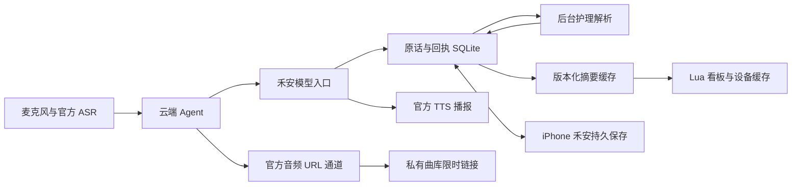

# 小聆开发与禾安定制

这套接入将小聆变成一个能记录护理、查询当天数据、显示看板、播放家庭曲库的桌面入口。已在 Arcs-Mini3、240×240 屏、固件 3.0.3 的开发设备上验证。其他固件和型号应重新验收。

名字与唤醒词保留“小聆 / 小聆小聆”。本项目没有刷写自定义固件，也没有训练唤醒模型。

## 先分清三个可定制层

| 层 | 本项目做了什么 | 文件 |
|---|---|---|
| 设备固件 | 沿用官方麦克风、ASR、扬声器、打断与网络能力 | 不分发固件 |
| 云端 Agent | 基于官方 SDK 保留对话生命周期，扩展私有播放器与按需打开 TTS | `agent/agent.ts`、`heanTools.ts`、`lazyResponse.ts` |
| Lua 小应用 | 绘制禾安数据看板、功能键切页、持久缓存、条件刷新 | `hean.lua` |
| 禾安服务 | 配对身份、原话持久化、护理处理、结果回执、摘要和媒体票据 | `server/voice-*.mjs`、`display.mjs`、`music.mjs` |



## 从零配置

1. 按[部署教程](deployment.md)启动 gateway，手机开启助手同步，生成 voice/display 两种配对文件。
2. 在[聆思平台](https://platform.listenai.com/)创建自己的开发产品，将设备加入此产品。安装官方 [ling CLI](https://github.com/LISTENAI/ling)。由用户本人在终端运行 `ling login` 并输入 API Key；不要把 API Key 发到聊天、写入源文件或执行日志。
3. 配置自定义 OpenAI-compatible 模型：base URL `https://你的域名/api/voice`，模型 `hean-care`，API Key 使用 voice 配对令牌。最终请求地址是 `/api/voice/chat/completions`。
4. 初始化自己的 Agent 配置。示例域名与产品 ID 必须替换。

```sh
cd devices/xiaoling/agent
python3 bootstrap.py
python3 configure.py --product-id YOUR_LISTENAI_PRODUCT_ID --origin https://hean.example.com
npm ci
npm run typecheck
npm test
ling app build --release
ling app deploy --version 0.1.6 --activate
cd ../../..
```

`bootstrap.py` 从官方地址下载 Agent SDK 0.1.1，核验 SHA-256 `54873b9658bc16197d11f6a0a71234eda380968faf8b823eb0c418b625fd6be1`，再提取 SDK 与官方 voice agent 模块。下载的 `sdk/`、`vendor/` 都被忽略，保留各自授权边界。`configure.py` 生成忽略的 `listenai.toml` 和 `config.local.ts`；开源模板不含个人设备 ID。

部署更新的是产品测试链中的云端 Agent，不是设备 OTA。若是共享产品，先确认测试设备的作用范围。版本回滚通过平台测试链选择上一版本；v0.1.4 有提前打开空 TTS 的问题，v0.1.5 包含修复。

5. 上传只读看板：

```sh
python3 devices/xiaoling/install.py --adb /path/to/adb \
  --credentials /private/hean-pair/display-link.json --serial DEVICE_SERIAL
```

安装器把配对值注入临时 Lua、通过 USB 推送 `/miniapp/hean.lua` 后清理本机临时文件。USB 调试源码在设备内存中，重启后需要重新载入；设备上的数据缓存保留。当前未实现独立于电脑的开机自启看板。

## 看板外观与按键

`hean.lua` 是实际信息屏。主题使用奶油底、暖橙色、清楚的奶量主数字，功能键切换今日概览与剩余量页。调整颜色、文字、布局在 Lua 中完成，固定尺寸为 240×240。`standby.html` 和六张 PNG 是角色待机/表情素材，不会替代实时信息屏。

修改后先用官方 [LingClaw SDK 模拟器](https://github.com/LISTENAI/LingClaw-SDK)预览；再推送设备验证字号、裁切、功能键、唤醒和刷新。未知数据显示 `--`；禁止用初始化的 0 冒充已知事实。跨天后不显示昨天奶量为今天奶量。

## 为什么看板会让语音记录失效

遇到了两个独立限制：云端的默认工具目录会随小应用状态收缩；设备端的 `app_mcp_tool_call_allowed()` 也会拦截当前小应用模式不允许的工具。于是默认助手可能回答“没有运行中的小应用”，或收到 `tool unavailable in current application mode`。

反复加强提示词、把工具名称改写成记录动作，都不能改变这些限制。退出看板能暂时记录，但破坏了同时显示数据的需求。

最终处理方法：

- 禾安模型入口分类最新一句输入，护理记录/查询/回执直接调用服务器内部护理服务，不经过设备原生小应用工具目录。
- 最新用户句与历史分开路由，避免把上一轮奶量查询或旧记录再执行一次。
- 原生音量、普通对话等仍使用官方能力。Lua 只负责读取摘要，不承载护理写入，也不接管麦克风。
- 服务器按配对 owner/profile 隔离，显示令牌不能调用记录工具。

复制 `system-prompt.txt` 只能调整行为说明，不能代替上述服务和 Agent 接入。`persona.txt` 被禾安模型入口实际加载；平台的人设文本与服务端规则要保持一致。

## 原生功能回归与固件限制

集成后的另一次故障并不是工具被禁用：真实 Agent trace 中有完整的 `take_photo` 定义和平台绑定，但主模型没有返回工具调用，只回答“好的”。旧路由把原生操作与普通闲聊都归入 `other`，再用 `tool_choice: auto`，允许模型只作口头回应；历史里重复的“好的”还会影响后续回答。此前验收关注了护理、看板和音乐，漏测了拍照。

路由修复位于 `server/voice-chat.mjs`：

1. 分类新增 `native`，根据本轮实际提供的工具目录选择 `native_tool`。拍宝宝照片是设备操作，不是护理记录；功能咨询、否定和假设不执行动作。
2. 对选中的工具强制生成调用。无参数工具如 `take_photo` 直接返回 `{}`；有参数工具只使用当前 schema 和指定的 `tool_choice`。模型只说“已完成”却没有调用时，按失败处理。
3. 原生调用交回官方 SDK 执行，保留原工具名称、摄像头预览、倒计时、图像处理和播报生命周期。服务不伪造摄像头结果。
4. SDK 带工具结果回来时不重新分类同一句、重复拍照或创建护理记录。查找后打开小应用等必要后续步骤仍可继续，禁止重复同名同参数操作。缺工具、未收到回执、执行失败分别如实回应。

在看板未运行时，真机日志验证了拍照倒计时、图像采集、`is_error=0` 回执和结果 TTS，也验证了设备真实音量/亮度查询。接口检查覆盖拍照、看眼前物品、调音量、调亮度、电量查询，以及“你会拍照吗”“不要拍照”不触发动作。路由检查不等同于每项功能都做过实体执行。

重新载入看板后，又复现了独立的固件限制：设备收到 `ls.built_in.take_photo` 后返回 `tool unavailable in current application mode`。官方 `apps/arcs-mini/mcp-tools/mcp_tool_miniapp.c` 的 `app_mcp_tool_call_allowed()` 限定小应用模式的原生工具；公开 Lua API 没有临时挂起/恢复看板接口，退出会释放源码并结束交互。因此**当前仍未实现拍照与看板共存**，不能把正常桌面拍照成功算成共存验收。

该拒绝在平台返回时还出现 `isError=false`、`agentStop=true`，导致静默结束。Agent v0.1.6 用 `nativeResults.ts` 识别这一条精确错误，恢复失败标记并继续生成明确的语音反馈；保留成功的图像、音乐和取消生命周期。不自动退出用户看板，也不冒充已拍照。彻底兼容需要单独设计固件的工具允许范围、相机界面与看板暂停/恢复、按键和会话状态，并完成实体回归；本次没有刷写固件。

最终真机复测确认：看板模式下拍照拒绝已产生明确回复并进入 TTS 播放；设置音量为原来的 70% 成功，期间看板条件请求持续返回 200。部分原生工具可用，不代表摄像头也被允许。

## 语音反馈与异步保存

一次调用的“已收到”“保存完成”“手机落盘”是三个不同状态。

1. 持久保存原话和请求编号；同一调用重试复用编号。
2. 明确的即时单笔奶量，例如“宝宝刚喝了 80 毫升奶”，走严格语法与通用记录校验，可立即保存并读回数量。否定、疑问、补记、纠正、中文数字、还在喝、多件事和正在进行的奶瓶会进入完整解析。
3. 持久接收后的解析等待预算为 200 ms（不包含 ASR、意图分类、网络和 TTS 时间），超出就返回“收到，正在保存”，后台继续工作。它不等待模型完成，也不会把处理中说成已保存。
4. 成功后云端摘要立即失效重算，看板刷新；手机打开后接收并落盘，才发送确认。失败或不清楚的原话进入待核对。当前不在已经结束的对话中主动补播第二条语音，可询问保存回执或查看 APP。

一个真实发现是：官方 response pipeline 在上下文准备前就发出 TTS URL，而设备空音频读取约 5 秒超时；旧护理入口先等 1.5 秒，再等 6 秒回执，还叠加模型分类时间。结果可能是数据保存了，声音却没了。

`LazyResponseProvider` 利用 SDK 的模块注入点推迟 eager `start()`，让官方 `write()/handleEvent()` 在第一段文字产生时才建立音频流，其他结束、取消、工具事件照常转发。未改 vendor 源码。测试覆盖慢解析仍先返回可播话术、后台成功、重试不重复以及取消生命周期。

## 缓存如何减少延迟

- SQLite 是权威存储。云端合并手机快照与未确认的语音结果，按宝宝版本缓存合并状态和当天摘要。
- 手机每 5 秒心跳，快照没变就不重新上传。服务端也不因空心跳或相同快照重新解析整份数据、增加版本或汇总全部记录。
- 真实写入、确认回执、修改或删除会失效缓存。手机同步时间仍更新；中国时区跨天会重新计算。
- 看板每 3 秒带 `since=version` 请求。未变化返回约百余字节的小 JSON；设备接口读不到响应头，所以没有依赖 HTTP ETag。
- 设备缓存同日可立即显示，离线标明缓存状态。持久缓存有效期 7 天，写入有节流；网络失败从 6 秒退避到 60 秒。

这不是绕开一致性：手机离线时本地新修改要等下一次同步；云端只报告自己已知的数据。不要缓存“已保存”的口头答案代替查询数据库。

## 私有儿歌，不依赖收费搜索

支持三个固定条目：`abc`、`lubinghua`、`playlist`。音乐文件由用户自行提供，仅放私有服务器 `STATE_DIRECTORY/music/`；仓库不附 MP3，也不自动从音乐平台获取。

设备兼容转码示例（对自己有权使用的输入）：

```sh
ffmpeg -i input.mp3 -map_metadata -1 -ac 1 -ar 44100 -b:a 96k abc.mp3
```

将文件以服务用户可读、其他用户不可读的权限存入 music 目录，然后注册：

```sh
node tools/assistant-admin.mjs music --state /var/lib/hean \
  --owner OWNER_ID --profile PROFILE_ID --id abc --file abc.mp3
node tools/assistant-admin.mjs music --state /var/lib/hean \
  --owner OWNER_ID --profile PROFILE_ID --id lubinghua --file lubinghua.mp3
```

需要连播时先将同样编码参数的两个文件用 ffmpeg concat 生成 `playlist.mp3`，再注册 `--id playlist --file playlist.mp3`。

服务签发绑定用户、宝宝和曲目的 1 小时票据；票据仅以散列存储，HTTP 支持 Range/206 和无效范围 416。Agent 验证固定 HTTPS 源站、固定曲目 ID、64 位票据，拒绝任意 URL 和额外参数。

专用音乐 MCP 在小应用模式仍可能受限。最终使用官方 `emitTTSStreamUrl` 音频 URL 通道播放用户文件，并沿用官方打断生命周期，因此音乐和看板能共存。唤醒会打断音乐；可以再点播，没有断点续播、混音或离线播放保证。没有 TF 卡时仍需要网络。

“我来播放”只是话术。验收必须看到服务器收到 GET、设备进入 PLAYING，并由人确认真正有声音。仅服务端 200 或 TTS 说已播放不算通过。

## 调试和回滚

- USB 日志使用 `adb shell`；此开发固件不支持常规 Android `adb logcat`。同一时刻只保留一个 shell 会话。
- 记录 `sid` 后用 `ling app trace SID` 查询云端 Agent 调用；`ling app request --text ...` 是模拟链路，不能替代麦克风与扬声器验收。
- 私密日志中可能有完整 ASR、临时 URL、设备 ID，公开问题报告只保留脱敏错误与时序。
- 查保存问题依次核对 receipt、status、records、手机 acknowledgedAt。界面更新不是播报完成，云端保存也不是手机已经落盘。
- 看板问题先重新载入 Lua，检查摘要权限、HTTP 状态、日期和缓存；不要为调试直接刷固件。

官方参考：[ling](https://github.com/LISTENAI/ling)、[LingClaw SDK](https://github.com/LISTENAI/LingClaw-SDK)、[ARCS Mini 固件源码](https://cloud.listenai.com/CSKG836746/arcs-sdk/public/arcs_mini)。下载的官方 SDK 以其自身条款为准；项目 MIT 只覆盖本项目原创代码。
